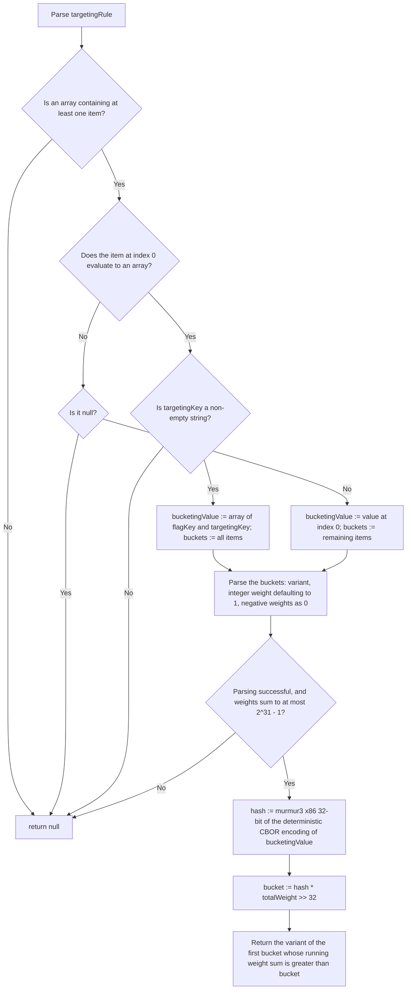

# Fractional Operation Specification

This evaluator allows to split the returned variants of a feature flag into different buckets,
where each bucket can be assigned a weight, representing how many requests will resolve to the corresponding
variant.

The distribution must be performed by hashing a bucketing value taken from the evaluation context and
mapping the hash to one of the buckets in proportion to their weights. It is important to note
that evaluations MUST be sticky, meaning that flag resolution requests with the same bucketing value
MUST always resolve to the same variant. To ensure that flag resolution requests yield the same result
regardless of which implementation of the in-process flagd provider is being used, the bucketing value is
encoded as deterministic CBOR and hashed with [MurmurHash3](https://github.com/aappleby/smhasher/blob/master/src/MurmurHash3.cpp),
as described below (see the [fractional hashing ADR](../../../architecture-decisions/fractional-non-string-rand-units.md)).

## Arguments

The supplied array must contain at least one item.

1. The first item is an optional JsonLogic expression for the bucketing value.
   - If it evaluates to anything other than an array (a string, number, boolean or object), that value is the
     bucketing value, and the remaining items are the buckets.
   - If it evaluates to `null`, the evaluator must log an error and return `null`.
   - If the first item is an array, it is the first bucket, and the bucketing value is the 2-element array
     `[flagKey, targetingKey]` (the `$flagd.flagKey` and `targetingKey` properties of the context). The
     `targetingKey` must be a non-empty string; otherwise the evaluator must log an error and return `null`.
2. Each bucket is an array of one or two items: the variant, and an optional weight.
   - The variant is a string, boolean, number or `null` (or an expression evaluating to one).
   - The weight is an integer relative weight. If no weight is specified, it must default to `1`.
     A negative weight must be treated as `0` (weights computed by other expressions can go negative).
     A weight that is not an integer is an error.
   - Each weight, and the sum of all weights, must not exceed `2147483647` (2^31 - 1, Int32 max);
     otherwise the evaluator must log an error and return `null`.

Any other malformed input must also be logged and result in `null`.

## Bucketing

1. Normalize numbers in the bucketing value: a number with no fractional part in the range
   [-2^63, 2^64 - 1] is encoded as an integer, and `-0` as `0`; any other number is encoded as a float.
2. Encode the bucketing value as CBOR using the
   [Core Deterministic Encoding Requirements](https://www.rfc-editor.org/rfc/rfc8949.html#section-4.2.1)
   of RFC 8949 (shortest-form numbers, map keys sorted bytewise).
3. Hash the encoded bytes with MurmurHash3 x86 32-bit (seed `0`) to an unsigned 32-bit integer `hash`.
4. Let `totalWeight` be the sum of the weights. If it is `0`, return `null`.
5. Compute `bucket = (hash * totalWeight) >> 32` with 64-bit unsigned arithmetic, an integer in
   `[0, totalWeight)`.
6. Walk the buckets in order, adding each weight to a running sum, and return the variant of the first bucket
   whose running sum is greater than `bucket`.

So each variant is selected for `weight / totalWeight` of bucketing values.

Below is an example of a targeting rule containing a `fractional`, with relative weights assigned to the variants:

```json
{
  "$schema": "https://flagd.dev/schema/v0/flags.json",
  "flags": {
    "headerColor": {
      "variants": {
        "red": "#FF0000",
        "blue": "#0000FF",
        "green": "#00FF00"
      },
      "defaultVariant": "red",
      "state": "ENABLED",
      "targeting": {
        "fractional": [
          {
            "cat": [
              { "var": "$flagd.flagKey" },
              { "var": "email" }
            ]
          },
          [
            "red",
            50
          ],
          [
            "blue",
            20
          ],
          [
            "green",
            30
          ]
        ]
      }
    }
  }
}
```

An example for a `fractional` targeting rule with no relative weights being assigned to the variants is listed below.
This will achieve an even distribution of the different variants:

```json
{
  "$schema": "https://flagd.dev/schema/v0/flags.json",
  "flags": {
    "headerColor": {
      "variants": {
        "red": "#FF0000",
        "blue": "#0000FF",
        "green": "#00FF00"
      },
      "defaultVariant": "red",
      "state": "ENABLED",
      "targeting": {
        "fractional": [
          {
            "cat": [
              { "var": "$flagd.flagKey" },
              { "var": "email" }
            ]
          },
          [
            "red"
          ],
          [
            "blue"
          ],
          [
            "green"
          ]
        ]
      }
    }
  }
}
```

Please note that the implementation of this evaluator can assume that instead of `{"var": "email"}`, it will receive
the resolved value of that referenced property, as resolving the value will be taken care of by JsonLogic before
applying the evaluator.

The following flow chart depicts the logic of this evaluator:



As a reference, below is a simplified version of the implementation of this evaluator in Go
(see `core/pkg/evaluator/fractional.go` for the full version, including number normalization).

```go
var cborEncMode, _ = cbor.CoreDetEncOptions().EncMode()

type weightedVariant struct {
    variant any // string, bool, number or nil
    weight  int64
}

/*
    values: contains the evaluated arguments; e.g.:
        ["test@faas.com", ["red", 50], ["blue", 20], ["green", 30]]
    flagKey, targetingKey: from the evaluation context
*/
func FractionalEvaluation(values []any, flagKey string, targetingKey any) any {
    if len(values) < 1 {
        return nil
    }

    // 1. Choose the bucketing value
    var bucketingValue any
    if _, isArray := values[0].([]any); !isArray {
        if values[0] == nil {
            return nil
        }
        bucketingValue = values[0]
        values = values[1:]
    } else {
        key, ok := targetingKey.(string)
        if !ok || key == "" {
            return nil
        }
        bucketingValue = []any{flagKey, key}
    }

    // 2. Parse the buckets
    var variants []weightedVariant
    var totalWeight int64
    for _, v := range values {
        bucket, ok := v.([]any)
        if !ok || len(bucket) == 0 {
            return nil
        }
        weight := int64(1)
        if len(bucket) >= 2 && bucket[1] != nil {
            w, ok := bucket[1].(float64)
            if !ok || w != math.Trunc(w) || w > math.MaxInt32 {
                return nil
            }
            weight = max(int64(w), 0)
        }
        totalWeight += weight
        variants = append(variants, weightedVariant{variant: bucket[0], weight: weight})
    }
    if totalWeight == 0 || totalWeight > math.MaxInt32 {
        return nil
    }

    // 3. Hash the deterministic CBOR encoding of the bucketing value
    bytes, err := cborEncMode.Marshal(normalizeValue(bucketingValue))
    if err != nil {
        return nil
    }
    hash := murmur3.Sum32(bytes)

    // 4. Map the hash to [0, totalWeight) and find its bucket
    bucket := (uint64(hash) * uint64(totalWeight)) >> 32
    var rangeEnd uint64
    for _, v := range variants {
        rangeEnd += uint64(v.weight)
        if bucket < rangeEnd {
            return v.variant
        }
    }
    return nil
}
```
