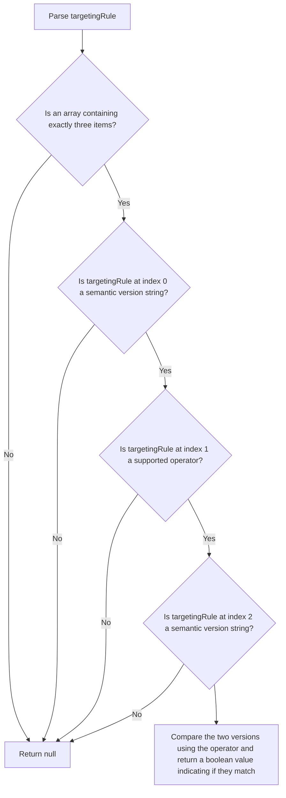

# Semantic Versioning Operation Specification

This evaluator checks if the given property within the evaluation context matches a semantic versioning condition.
It returns 'true', if the value of the given property meets the condition, 'false' if not.

```js
{
    "if": [
        {
            "sem_ver": [{"var": "version"}, ">=", "1.0.0"]
        },
        "red", null
    ]
}
```

The implementation of this evaluator should accept the object containing the `sem_ver` evaluator
configuration, and a `data` object containing the evaluation context.
The 'sem_ver' evaluation rule contains exactly three items:

1. Target property value: the resolved value of the target property referenced in the targeting rule
2. Operator: One of the following: `=`, `!=`, `>`, `<`, `>=`, `<=`, `~` (match minor version), `^` (match major version)
3. Target value: this needs to resolve to a semantic versioning string.

Both versions are parsed as [Semantic Versioning 2.0.0](https://semver.org/) versions, with these allowances:

- a leading `v` or `V` is ignored (`v1.2.3` is `1.2.3`);
- `MAJOR` and `MAJOR.MINOR` are accepted as shorthand for `MAJOR.0.0` and `MAJOR.MINOR.0`;
- a number is converted to a string first (`1.2` is `1.2.0`).

Anything else that isn't a valid version (for example `01.2.3`, `1.2.3.4` or `beta`), an unsupported operator,
or an array that doesn't contain exactly three items is an error: the evaluator should log an appropriate error
message and return `null`.

The operators compare the two versions as follows:

- `=`, `!=`, `>`, `<`, `>=`, `<=` use SemVer precedence: a pre-release version is lower than its release
  (`1.0.0-rc.1` < `1.0.0`), pre-release identifiers are compared as SemVer specifies, and build metadata
  (`+build.5`) is ignored.
- `^` is true when the major versions are equal (`1.9.0 ^ 1.0.0` is true, `2.0.0 ^ 1.0.0` is false).
- `~` is true when the major and minor versions are equal (`1.2.9 ~ 1.2.0` is true, `1.3.0 ~ 1.2.0` is false).

Unlike npm's caret and tilde ranges, `^` and `~` only compare these components: the patch version and pre-release
are ignored, and the comparison is symmetric.

The `sem_ver` evaluation returns a boolean, indicating whether the condition has been met.

Please note that the implementation of this evaluator can assume that instead of `{"var": "version"}`, it will receive
the resolved value of that referenced property, as resolving the value will be taken care of by JsonLogic before
applying the evaluator.

The following flow chart depicts the logic of this evaluator:


